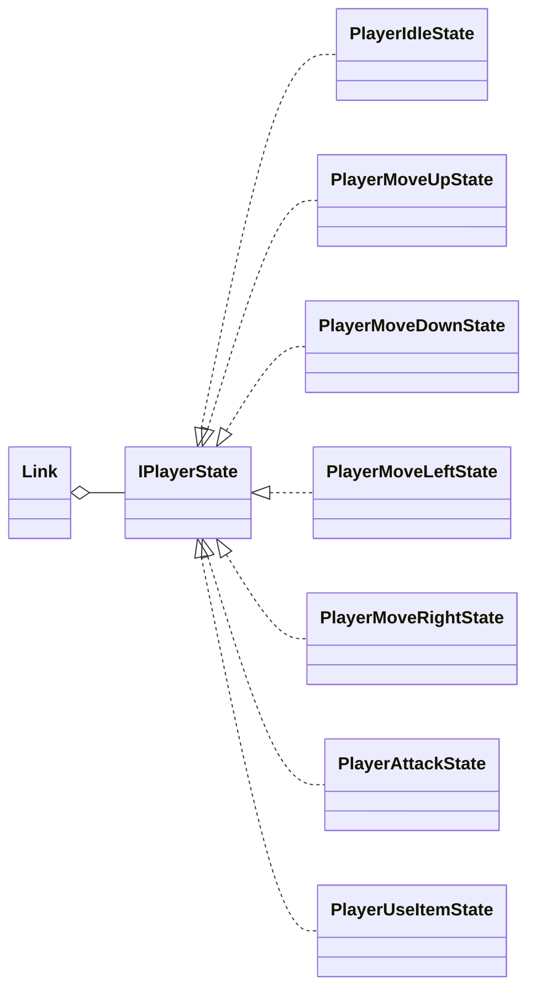

# CSE3902 Project: Interactive Systems

> Group 5, AU2026 @ OSU

### Authors:

- Ayush Saggar (saggar.9@osu.edu) - [Podzied](https://github.com/Podzied)
- Baowen Liu (liu.11884@osu.edu) - [PowerSixxx](https://github.com/PowerSixxx)
- Ethan Singh (singh.2164@osu.edu) - [ethansingh123](https://github.com/ethansingh123)
- Jack Rose (rose.1775@osu.edu) - [Ra4ster](https://github.com/ra4ster)
- Tyler Brown (brown.9452@osu.edu) - [Brownt13487](https://github.com/Brownt13487)

---

## Project Description

This project is a 2D dungeon exploration game framework built in C# using MonoGame. Designed around Agile software development principles, it mimics the mechanics of the original NES Legend of Zelda. The current iteration features a modular entity-component design, a state-machine-driven player character (Link), and extensible interfaces for blocks, enemies, items, and projectiles.

As of Sprint 3 the dungeon is loaded from JSON room files in `Byte/Content/Rooms` (nothing about the layout is hard coded), Link collides with walls, enemies, items and doors, and walking into a door takes you to the next room. The room file format is written up in [DESIGN.md](DESIGN.md#1-core-loop-and-level-loading-bytecore).

## Running it

You need the .NET 10 SDK. From the repo root:

```
dotnet run --project Byte
```

The headless collision checks run the same way:

```
dotnet run --project Tests/CollisionChecks
```

## Controls

**Player Actions**

- **Movement:** `W`, `A`, `S`, `D` (or Arrow Keys)
- **Attack (Sword):** `Z` or `N`
- **Use Item/Projectile:** `1` (Arrow), `2` (Bomb), `3` (Boomerang)
- **Take Damage (Debug):** `E`

**Rooms**

- **Change Room:** walk into a door (blue box)
- **Previous / Next Room (debug):** `[` / `]`
- **Hitbox colors:** red Link, yellow sword, green wall, light green floor, orange enemy, magenta item, blue door

**System Controls**

- **Reset Game:** `R` (Full level reload from the room data files)
- **Quit:** `Q`

## Documents

- [Requirements](REQUIREMENTS.md)
- [Design document](DESIGN.md): how each component works and which design patterns it uses
- [Sprint 2 reflection](SPRINT2REFLECTION.md)
- [Link collision behavior and checks](Documentation/LinkCollisions.md)
- [Code review transcript](Documentation/ClaudeAnalysis.md): the Sprint 2 code analysis deliverable

## Known Bugs

- **No death state:** Link stays at 0 HP until you press `R`.
- **Tight doors:** Link's hitbox is one tile and so is the door gap. He gets nudged in if he's within a quarter tile, otherwise he stops on the wall.
- **Barrier tile entry:** Link can arrive in barrier tiles from doors.
- `ProcessCollisions` creates a new `CollisionDetector` and a list for every block × projectile and block × enemy pair, every frame. Blocks sit on a grid, so you could look up only the cells under a hitbox instead of scanning every block.

## Tools & Processes Used

1. **Performance Profiling (dotnet-trace & Speedscope):** We recorded traces of the game loop with `dotnet-trace` and opened them in Speedscope to see where `Update()` and `Draw()` spend their time. The trace is `Documentation/Byte.speedscope.json`.
2. **Visual Studio Diagnostic Tools:** Heap, memory and CPU/GPU usage from the built-in diagnostics in Visual Studio Community.
3. **Code review:** Each PR gets one reviewer before merge. Code analysis is also done as a chat review, transcript in `Documentation/ClaudeAnalysis`.
4. **Collision checks:** `Tests/CollisionChecks` is a small console program that runs Link into blocks, enemies, items and doors without a window and fails loudly if a rule breaks.

## Visualization of Player States



---

> Access CSE3902 resources [here](https://jholewinski.github.io/cse3902/index.html)!
